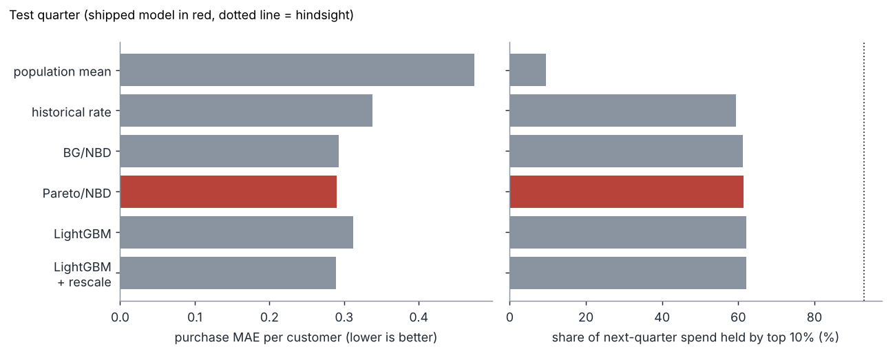
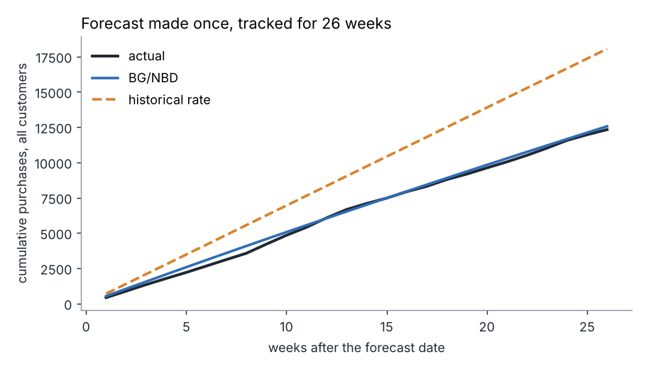
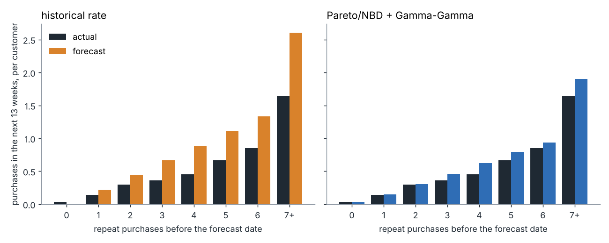
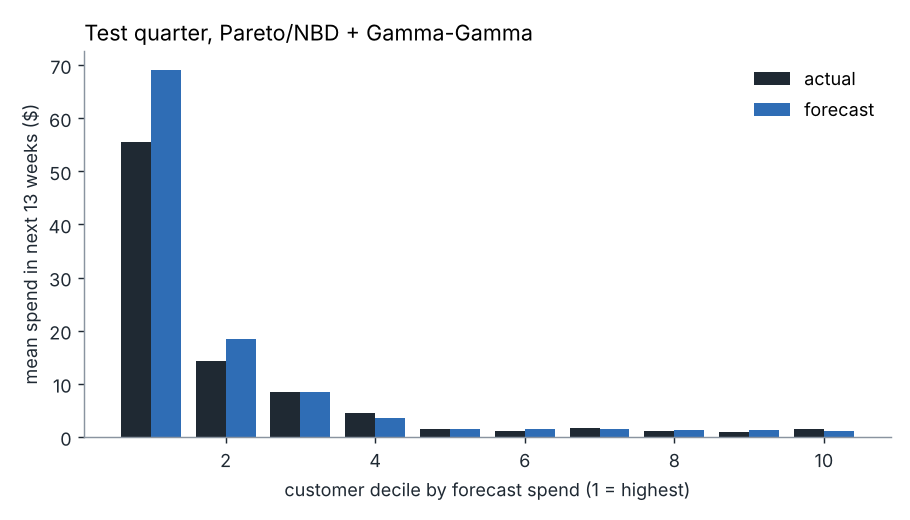
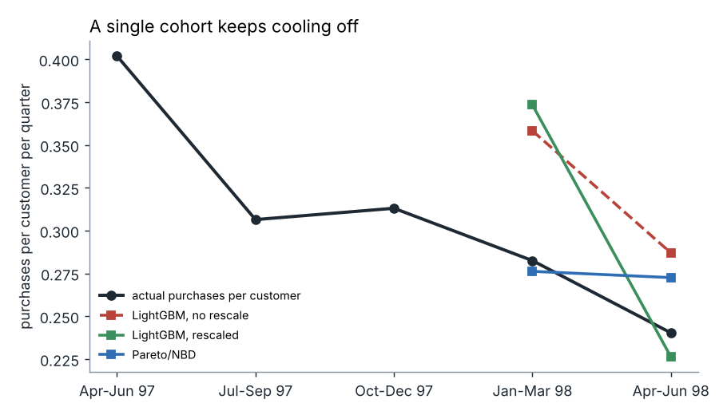
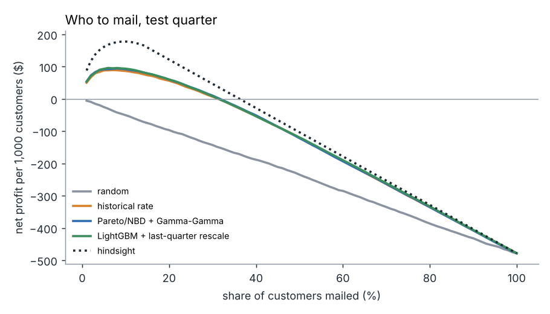

# secondorder

[](https://github.com/ranjithguggilla/secondorder/actions/workflows/ci.yml)

Forecast how many orders each customer will place over the next 13 weeks, and how much they will spend, using nothing but their purchase history. The project compares a spreadsheet-style rate, two probabilistic "buy till you die" models (BG/NBD and Pareto/NBD, each paired with a Gamma-Gamma spend model) and gradient boosting, and judges them the way a marketing team would live with them: quarter by quarter, forward in time, in dollars.

I built it around the CDNOW order log, where 51% of customers never place a second order. That single fact drives most of the interesting behaviour in the results below.

## Results

The data are 23,570 customers who all made their first purchase in the first quarter of 1997, followed until June 1998. I cut the timeline into 13-week quarters. Models are trained on the early quarters, a validation quarter picks the winner, and the last quarter (April to June 1998) is scored once.

Test quarter, 23,570 customers, 5,664 actual orders, $213,400 actual spend:

| model | purchase MAE | purchase bias | spend MAE ($) | share of spend in top 10% of list |
|---|---|---|---|---|
| population mean | 0.474 | +35.6% | 18.35 | 9.6% |
| historical rate | 0.338 | +50.0% | 13.12 | 59.4% |
| BG/NBD + Gamma-Gamma | 0.293 | +13.2% | 11.33 | 61.3% |
| **Pareto/NBD + Gamma-Gamma (shipped)** | **0.290** | +13.4% | 11.21 | 61.4% |
| LightGBM | 0.313 | +19.4% | 11.57 | 62.2% |
| LightGBM + last-quarter rescale | 0.289 | -5.8% | 10.23 | 62.2% |

The best a perfect ranking could do is put 93.0% of next-quarter spend in the top 10%, so 61% is real signal but far from the ceiling. Most of that gap is irreducible: even a loyal customer buys or does not buy in any given quarter.

Things worth knowing before trusting the table:

- Pareto/NBD ships because the selection rule is "the simplest model within one bootstrap standard error of the best validation purchase MAE", and BG/NBD sits further than that from Pareto/NBD on validation (0.327 vs 0.322). On test the gap is tiny but real: BG/NBD is worse by 0.0033 purchase MAE, 95% interval [0.0027, 0.0040].
- Against the historical rate the shipped model cuts purchase MAE by 14% (difference 0.048, interval [0.045, 0.051]) and spend MAE by $1.91 ([1.70, 2.15]).
- The rescaled boosting model ties the shipped one on purchases (difference -0.0005, interval [-0.0032, +0.0020]) and beats it on spend MAE by $0.97 ([0.80, 1.14]). I did not ship it. The rescale factor came out at 1.04 on validation, where it made things slightly worse, and 0.79 on test, where it helped. A correction that swings that much from one quarter to the next is not something I would put in front of a planner.
- Every model forecasts too high on test. The cohort keeps cooling off: orders per customer per quarter fell from 0.402 to 0.306, 0.313, 0.282 and 0.240. Probabilistic models absorb part of that through lapse probabilities but not all of it.



### Tracking a forecast over time

Fit once on everything up to the end of 1997 and projected 26 weeks forward, BG/NBD finishes within 1.9% of the 12,322 orders that actually arrived. Extrapolating each customer's historical rate overshoots by 46.4%.



### Where the historical rate goes wrong

Grouped by how many repeat purchases a customer had made, the historical rate overstates every group, and the heavier the buyer the worse it gets. The probabilistic model shrinks high-frequency customers toward what such customers really do.



### Who actually generates revenue

At the start of the test quarter 52.7% of customers had never bought twice. They produced 6.5% of the quarter's spend, and 3.0% of them ordered again, compared with 26.5% of customers who had already repeated. Among repeat buyers, the model's "chance still active" separates behaviour well:

| P(alive) band, repeat buyers | customers | bought in the quarter | mean spend ($) |
|---|---|---|---|
| 0.0 to 0.2 | 1,717 | 7.6% | 3.78 |
| 0.2 to 0.4 | 1,365 | 11.8% | 4.93 |
| 0.4 to 0.6 | 1,082 | 17.6% | 8.42 |
| 0.6 to 0.8 | 1,500 | 21.1% | 10.21 |
| 0.8 to 1.0 | 5,478 | 39.3% | 29.55 |



### Why gradient boosting needs care here

The boosted model trains on customers aged up to 38.7 weeks and is then asked about customers aged 51.7 weeks (validation) and 58.6 weeks (test). Trees cannot extrapolate past what they saw, so raw LightGBM overshoots by 26.8% on validation and 19.4% on test. The probabilistic models have the ageing built into their structure, which is why they hold up with far fewer moving parts.



### Money

The campaign model is deliberately plain. A mailing costs $0.75 per customer, a CD order carries a 30% contribution margin, and I assume contacted customers spend 10% more than they otherwise would. Under those assumptions a contact breaks even at $25 of expected quarterly spend. The 10% lift is a guess, not something this dataset can measure, so I show how the answer moves with it.

Net profit per 1,000 customers in the test quarter, mailing the best-ranked slice (list size chosen with hindsight on the test quarter, so these are best cases):

| ranking | lift 5% | lift 10% | lift 20% |
|---|---|---|---|
| random order | -6.6 | -5.7 | -3.7 |
| historical rate | 28.5 | 89.2 | 262.6 |
| shipped model | 30.3 | 94.2 | 272.2 |
| boosting + rescale | 30.1 | 95.9 | 272.5 |
| perfect hindsight | 61.8 | 177.5 | 439.0 |

At the 10% lift the shipped model's best list is 8% of customers. Mailing everyone loses $478 per 1,000 customers. The gap between the shipped model and the historical rate is about $5 per 1,000 customers per quarter, so the model matters less than simply not mailing the whole file and picking a sensible cut-off.



## Architecture

```
 data/cdnow_master.txt          69,659 order lines, 23,570 customers
          |
          v
   data.py  ---- collapse to one row per customer per day
          |
          v
 windows.py ---- five origins, 13 weeks apart
          |        features: history up to the origin only
          |        targets : the 13 weeks after it
          |
   +------+--------------------------------------------+
   |  train origins 1-3   validation origin 4   test origin 5
   v                                                      |
 models.py                                                |
   mean / historical rate / BG-NBD / Pareto-NBD /         |
   LightGBM (+ rescale)  --> one-SE selection on validation
          |                                               |
          +------------------> scored once on test <------+
                                    |
          +-------------------------+----------------------+
          v                         v                      v
    evaluate.py               economics.py             score.py --> app.py
  MAE, deciles, bootstrap   profit vs list size     single-customer scorer
          |                         |                      (Gradio)
          +-----------+-------------+
                      v
            outputs/metrics.json, assets/*.png
```

## Installation

```bash
git clone https://github.com/ranjithguggilla/secondorder.git
cd secondorder
python -m venv .venv && source .venv/bin/activate
pip install -r requirements.txt
pip install -e .
```

Python 3.11 or newer. The results above were produced on Python 3.13.

## Usage

1. Run the full pipeline. It reads the bundled order log, fits every model, scores the test quarter and writes charts and metrics. It takes about a minute.

   ```bash
   python -m secondorder.pipeline
   ```

2. Read the numbers in `outputs/metrics.json`, or open the charts in `assets/`.
3. Launch the single-customer scorer.

   ```bash
   python -m secondorder.app
   ```

4. Enter repeat purchase days, weeks from first to last purchase, weeks since the first purchase and average spend per repeat purchase. The app returns the chance the customer is still active, expected orders and spend for the next 13 weeks, and a plain-language call.

To score from Python:

```python
from secondorder.score import CustomerInput, load_scorer

scorer = load_scorer()
scorer.score(CustomerInput(frequency=8, recency=50, age=52, monetary_value=40))
```

## Configuration

There is no config file; the knobs are named constants and arguments.

| setting | where | default |
|---|---|---|
| forecast horizon | `HORIZON_DAYS` in `windows.py` | 91 days |
| first origin | `FIRST_ORIGIN` in `windows.py` | 1997-03-31 |
| boosting grid | `BOOST_GRID` in `pipeline.py` | shallow, medium, deep |
| campaign assumptions | `CampaignAssumptions` in `economics.py` | 30% margin, $0.75 per contact, 10% lift |
| data path, output folder | `--data`, `--out` flags | `data/`, `outputs/` |
| skip the boosting grid | `--quick` flag | off |

## Output structure

```
outputs/
  metrics.json          every number quoted in this README
  model_params.json     fitted purchase and spend parameters, loaded by the scorer
  scored_customers.csv  test-quarter customers ranked by forecast spend (not committed)
assets/
  *.png                 charts used above
```

## Project structure

```
secondorder/
  src/secondorder/
    data.py        load and clean the order log
    windows.py     origins, features, targets, leakage guard
    models.py      baselines, BG/NBD, Pareto/NBD, boosting, rescale wrapper
    evaluate.py    metrics, calibration tables, paired bootstrap
    economics.py   campaign profit curves and sensitivity
    pipeline.py    end-to-end run and charts
    score.py       validated single-customer scorer
    app.py         Gradio front end
  tests/           pytest suite
  data/            cdnow_master.txt
  assets/          README charts
  ci/ci.yml        workflow source (installed to .github/workflows by publish.sh)
```

## Technical details

Origins and leakage. There are five origins, one horizon apart (31 March, 30 June, 29 September and 29 December 1997, then 30 March 1998). Features at an origin use purchases on or before it. Targets use the next 91 days. The first three origins train the boosting model. The fourth is the validation quarter. The fifth is the test quarter, scored once. A guard function confirms that no training label window ends after the origin being scored; a unit test breaks it on purpose. Every customer's first purchase predates the first origin, so each origin covers the same 23,570 people. That is a clean cohort but also a limit, discussed below.

Probabilistic models. BG/NBD and Pareto/NBD (from `lifetimes`) are fitted on frequency, recency and age in weeks, with a small penalizer. They never see future orders. Spend uses Gamma-Gamma on each repeat buyer's mean order value; customers with no repeat purchases get the population mean order value.

Boosting. LightGBM with a Poisson objective for orders and a Tweedie objective (power 1.4) for spend, on 19 features such as recent order counts, average gap between orders and last order value. A three-point grid is searched on validation deviance. A rescale wrapper multiplies forecasts by the ratio of actual to forecast in the last finished quarter, using a model trained only on earlier origins so that ratio is out of sample.

Selection. Simplest model whose validation purchase MAE is within one bootstrap standard error of the best. Paired customer-level bootstraps (200 resamples) give the intervals on test.

Shuffled cross-validation. Five-fold shuffled CV on the pooled training quarters gives a Poisson deviance of 0.858, against 0.724 for the same boosting setup scored forward on the validation quarter. The shuffled number is not simply optimistic; it mixes quarters and scatters each customer across folds, so it answers a different question from "how will this do next quarter". I kept the forward numbers as the reported ones.

Limits. One acquisition cohort from a single retailer in 1997 and 1998, with no prices, promotions, channels or demographics. The 10% campaign lift is an assumption. Two quarters of drift is not enough to promise how the rescale behaves in general. The data allow a good comparison of forecasting methods; they do not support claims about lifetime value over years.

## Testing

```bash
pip install -r requirements-dev.txt
ruff check .
pytest --cov=secondorder
```

39 tests, 98% line coverage, ruff clean. They cover the data loader, the hand-computed features and the future-blind property of the feature builder, the leakage guard, every model's basic behaviour, bootstrap and metric maths, campaign profit arithmetic on a four-customer list, input validation and ordering sanity in the scorer, a full pipeline run on synthetic data, and checks on the committed metrics file. The workflow in `ci/ci.yml` runs lint and tests on each push and pull request and, on main, retrains and uploads the metrics and charts.

## Dataset

CDNOW order log (customer id, date, CDs, dollar value) from Peter Fader and Bruce Hardie's published data at https://www.brucehardie.com/datasets/, obtained through the `lifetimes` repository at https://github.com/CamDavidsonPilon/lifetimes (file `lifetimes/datasets/CDNOW_master.txt`, MIT license). 69,659 order lines from 23,570 customers, 1 January 1997 to 30 June 1998.

## License

MIT. See `LICENSE`.
